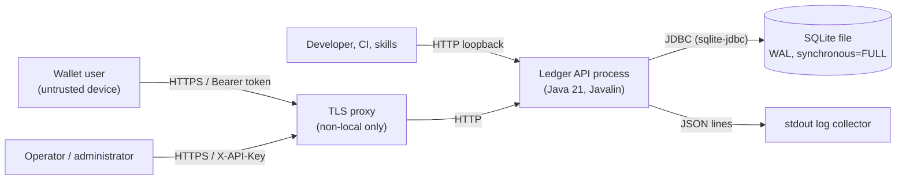
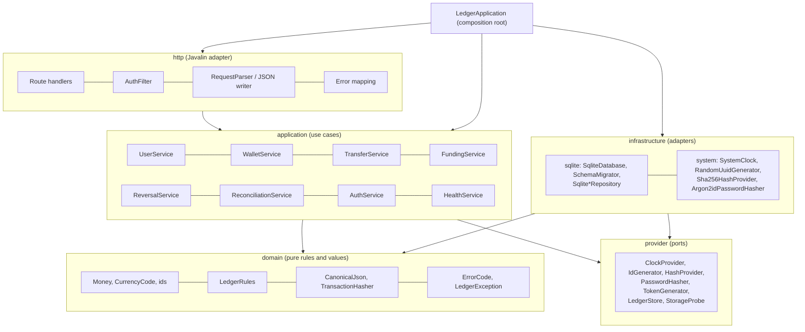

# Architecture and Design

**Stage:** 2 (Design) · **Specification:** [`docs/srs.pdf`](../srs.pdf) · **Decisions:** [`docs/adr/`](../adr/README.md)

This document describes how the Financial Ledger & Digital Wallet API is built: its components, the paths a request takes, where each invariant is enforced, and how the design is verified. Diagrams are in [`uml.md`](uml.md) (class and sequence) and [`data-model.md`](data-model.md) (ER and physical schema).

---

## 1. Goals and Constraints

| Driver | Source | Design response |
|--------|--------|-----------------|
| Every balance change is a balanced two-entry transaction | BR-4, FR-1.8 | Services build both entries together; DB trigger checks each entry against its transaction; reconciliation C1–C3 |
| No lost updates, no overdraft under concurrency | FR-3.1–FR-3.3 | One writer connection, fair lock, `BEGIN IMMEDIATE` ([ADR-0003](../adr/0003-sqlite-write-serialization.md)) |
| Retries never duplicate money movement | FR-2.5–FR-2.10, NFR-REL-4 | Idempotency record committed in the same transaction ([ADR-0005](../adr/0005-idempotency-records.md)) |
| History is immutable and tamper-evident | BR-8, FR-4.1, FR-4.5 | Append-only triggers, SHA-256 hash chain ([ADR-0004](../adr/0004-canonical-json-and-hash-chain.md), [ADR-0007](../adr/0007-schema-constraints-and-append-only-triggers.md)) |
| Exact integer money | BR-1, BR-12, DC-5 | `long` minor units, token-level parsing, checked arithmetic ([ADR-0006](../adr/0006-money-and-numeric-representation.md)) |
| Testable without real I/O | DC-4, NFR-MNT-1/2 | Provider ports, composition root ([ADR-0002](../adr/0002-layered-hexagonal-architecture.md)) |
| Java 21, Maven, SQLite only | DC-1, DC-2 | Javalin + sqlite-jdbc, shaded jar ([ADR-0001](../adr/0001-java-javalin-maven-stack.md)) |

---

## 2. System Context



One process owns one database file (A-2). The default listen address is `127.0.0.1` (NFR-SEC-6); any non-local exposure sits behind TLS 1.2+ (NFR-SEC-8).

---

## 3. Layers and Components



Dependencies point inward only. `domain` imports nothing outside the JDK; `application` imports `domain` and `provider`; JDBC and Javalin types never cross into them (NFR-MNT-1). The full class diagram is in [`uml.md` §1](uml.md#1-class-diagram).

### 3.1 Package responsibilities

| Package | Responsibility | Status |
|---------|----------------|--------|
| `org.ledgerapi.config` | Environment configuration, validation without echoing values | Implemented |
| `org.ledgerapi.domain` | Money, identifiers, timestamps, error catalogue, ledger rules, canonical JSON, hashing input | Partly implemented (`ErrorCode`, `LedgerException`, `FieldError`, `Timestamps`) |
| `org.ledgerapi.provider` | Ports for clock, IDs, hashing, storage | Implemented: `ClockProvider`, `IdGenerator`, `HashProvider`, `StorageProbe`; planned: `PasswordHasher`, `TokenGenerator`, `LedgerStore` |
| `org.ledgerapi.application` | Use cases and transaction boundaries | `HealthService`, `BuildInfo` implemented; the rest planned ([plan](../plan.md)) |
| `org.ledgerapi.infrastructure.sqlite` | Connections, pragmas, migrations, repositories | `SqliteDatabase`, `SchemaMigrator`, schema V1 implemented |
| `org.ledgerapi.infrastructure.system` | System clock, UUID v4, SHA-256, Argon2id | Clock, UUID and SHA-256 implemented |
| `org.ledgerapi.http` | Routing, request IDs, error envelope, request logging, handlers | Pipeline and `/health` implemented |

---

## 4. Runtime Views

### 4.1 Startup (FR-6.2, FR-6.4)

1. `Main` loads `AppConfig` from the environment. An invalid value exits with code 2 and a message that names the variable but not its value.
2. `SqliteDatabase.open` creates the parent directory, opens one writer and N readers with the required pragmas.
3. `SchemaMigrator.migrate` runs in one write transaction: apply missing schema versions, reject a newer schema, verify persisted currencies against configuration, insert new currencies with zero-balance SYSTEM accounts. An incompatible database exits with code 2.
4. Javalin binds to the configured address and port; the log records `started` with the port and version.
5. A JVM shutdown hook calls `LedgerApplication.close()`: stop accepting HTTP requests, let in-flight requests finish, wait for the write lock, close connections (FR-6.3).

### 4.2 Request pipeline (SRS §4.4, [ADR-0009](../adr/0009-request-pipeline-and-error-handling.md))

```
request ─► X-Request-Id ─► route/method (404/405) ─► media type (415) ─► size (413)
        ─► authenticate (401) ─► authorize role (403)
        ─► parse + structural validation (400 VALIDATION_ERROR / INVALID_AMOUNT / MALFORMED_ID /
           MISSING_IDEMPOTENCY_KEY / INVALID_IDEMPOTENCY_KEY)
        ─► [money-moving] write lock (503) ─► fingerprint ─► ownership (404/403)
           ─► replay (201 + Idempotency-Replayed) | key reuse (422)
           ─► business rules (400 UNSUPPORTED_CURRENCY / 422 ...) ─► writes ─► commit ─► 201
        ─► [reads] read snapshot ─► existence (404) ─► ownership (403) ─► 200
        ─► request log record (requestId, method, path, status, durationMs, errorCode)
```

### 4.3 Money-moving write path (FR-3.1)

All steps below run inside **one** `BEGIN IMMEDIATE` transaction on the single writer connection, under the fair write lock. Sequence diagrams for new transfers, replays, races, lock timeouts, funding and reversal are in [`uml.md` §2](uml.md#2-sequence-diagrams).

1. Compute the request fingerprint ([ADR-0004](../adr/0004-canonical-json-and-hash-chain.md)).
2. Transfer only: load the source wallet (404 if absent) and check it belongs to the session user (403).
3. Look up `(principal, key)`: equal fingerprint → return stored response; different → 422.
4. Business checks in SRS order (FR-2.3 / FR-4.4 / FR-1.7).
5. Allocate `sequence = MAX(sequence)+1`, two entry numbers `MAX(entry_number)+1, +2`.
6. Compute new balances with `Math.addExact` / `subtractExact`.
7. Read `previousHash` (hash of the last sequence, or 64 zeros), build the transaction representation, compute `hash`.
8. Insert `ledger_transaction`, two `ledger_entry` rows, update both `account.balance` values.
9. Insert `idempotency_record` with the exact response body.
10. Commit. Only now is 201 returned and the `ledger.transaction` log record written.

Any exception between steps 1 and 10 rolls back everything; no sequence, entry number, balance or key is consumed (BR-11, FR-2.8, FR-3.8).

### 4.4 Read path (FR-3.7)

Reads borrow a read-only connection and run all their queries in one deferred transaction, so a response that combines rows (user with wallets, wallet with balance, reconciliation) reflects a single committed state. Readers never take the write lock; WAL lets them proceed during writes.

---

## 5. Invariant Enforcement Matrix

Each invariant has at least two independent guards: the service prevents violations, and either the database rejects them or reconciliation detects them.

| Invariant | Service layer | Database | Reconciliation |
|-----------|---------------|----------|----------------|
| BR-4 two balanced entries | Services always insert one DEBIT and one CREDIT with the transaction amount | `UNIQUE(transaction_id, direction)`; entry-match trigger; amount CHECKs | C1, C2 |
| BR-5/FR-1.8 balance = credits − debits | Balance updated in the same transaction as entries | Balance type and range CHECKs | C3 |
| BR-6 wallet ≥ 0 | `INSUFFICIENT_FUNDS` check | `CHECK (kind='SYSTEM' OR balance BETWEEN 0 AND 2^53−1)` | C4 |
| BR-7 amount and balance limits | Parser and `Money` validation, `BALANCE_LIMIT_EXCEEDED`, `NUMERIC_LIMIT_EXCEEDED` | Amount and balance CHECKs | C1, C4 |
| BR-8 append-only | No update/delete code paths exist | `RAISE(ABORT)` triggers | C6 hash chain |
| BR-10 conservation | Follows from BR-4 per currency | Composite currency FKs | C5 |
| BR-11 gap-free numbering | Allocation inside the write transaction | `UNIQUE sequence`, entry PK | C6 |
| One SYSTEM account per currency | Migrator creates exactly one | Partial unique index | C5 |
| One reversal per original | `ALREADY_REVERSED` check | `UNIQUE reversal_of` | C7 |
| Idempotency at most once | Lookup under write lock | PK `(principal_id, idempotency_key)`, `UNIQUE transaction_id` | n/a |

---

## 6. Configuration

| Variable | Default | Rule |
|----------|---------|------|
| `LEDGER_LISTEN_ADDRESS` | `127.0.0.1` | non-blank |
| `LEDGER_PORT` | `8080` | 0–65535 (`0` = ephemeral, used by tests and `local-check`) |
| `LEDGER_DB_PATH` | `data/ledger.db` | valid path; parent created |
| `LEDGER_CURRENCIES` | `INR:2,USD:2,EUR:2` | `CODE:EXPONENT`, ISO-style uppercase code, exponent 0–18, no repeats |
| `LEDGER_SESSION_LIFETIME_MINUTES` | `60` | 1–1440 |
| `LEDGER_ARGON2_MEMORY_KIB` / `_ITERATIONS` / `_PARALLELISM` | `19456` / `2` / `1` | not below the SRS minimum |
| `LEDGER_ADMIN_KEYS` | empty | `principalId=sha256hex`, comma-separated, unique hashes |
| `LEDGER_TRUSTED_PROXIES` | empty | comma-separated IP addresses |
| `LEDGER_READ_POOL_SIZE` | `8` | 1–64 |
| `LEDGER_LOCK_TIMEOUT_MS` | `5000` | 1–60000 |

Invalid configuration stops startup with exit code 2 and never prints a value (SRS §4.6).

---

## 7. Cross-Cutting Concerns

* **Security:** Argon2id passwords, hashed opaque sessions, hashed admin keys, bound SQL parameters only, generic errors, throttling ([ADR-0008](../adr/0008-authentication-and-sessions.md)).
* **Observability:** one JSON log record per request and per committed transaction, no bodies or secrets ([ADR-0012](../adr/0012-structured-logging-and-observability.md)).
* **Time:** all timestamps come from `ClockProvider` and are formatted as UTC RFC 3339 with milliseconds (`Timestamps.format`). Order is defined by sequence, not time (A-5).
* **Identifiers:** lowercase UUID v4 from `IdGenerator`; tests use `SequentialIds` for reproducible hashes.

---

## 8. Integrity Limits

Triggers stop ordinary `UPDATE`/`DELETE`. Reconciliation detects edits that break accounting rules or the hash chain. Neither stops a privileged operator from dropping triggers and rewriting a self-consistent database, and deletion of a valid suffix cannot be detected without an external checkpoint. This matches SRS §2.7 and is stated in the user documentation.

---

## 9. Verification Strategy

| Level | Scope | Database | Examples |
|-------|-------|----------|----------|
| Unit (TQ-1) | `domain`, `application` with fakes | none or in-memory | canonical JSON vectors, hash chain, amount parsing, checked arithmetic, rule ordering |
| Integration (TQ-2) | `infrastructure.sqlite` | temp file, WAL | pragmas, triggers, rollback on injected failure, lock timeout, restart, crash recovery |
| System (TQ-3) | Full HTTP | temp file, WAL | each FR-1..FR-7 flow through `HttpClient` |
| Negative (TQ-4) | HTTP | temp file | every error code, precedence of the §4.4 order, concurrent same-key/different-key |
| Precision (TQ-6) | parser, reconciliation | temp file | decimals and exponents rejected, totals above 2^53−1 exact |
| Skills (TQ-7) | `local-check`, later `simulate-transfer` | disposable | recorded in `docs/skill_evaluations.md` |
| Performance | Section 6.1 workloads | temp file | Stage 3 harness, reference hardware recorded |

Current evidence: 48 automated tests (configuration, error catalogue, timestamps, health service, HTTP support, health end-to-end including request logging, SQLite pragmas/locking/snapshots, schema migration and triggers), all passing with the coverage gate.
