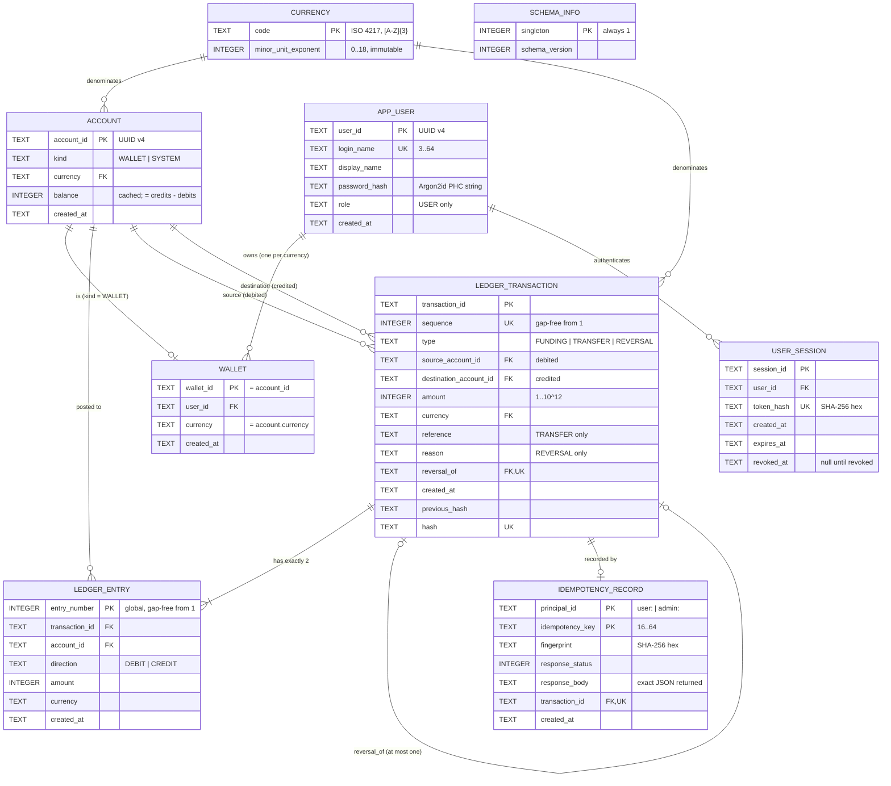

# Data Model

**Stage:** 2 (Design) · **Logical model:** SRS §9 · **Physical schema:** [`V1__initial_schema.sql`](../../src/main/resources/db/V1__initial_schema.sql) · **Decision:** [ADR-0007](../adr/0007-schema-constraints-and-append-only-triggers.md)

The ER diagram and tables below describe schema version 1 exactly as `SchemaMigrator` applies it. A schema change must update this file, the SQL migration and the diagram in the same pull request (DC-8).

---

## 1. ER Diagram

Administrator key hashes are configuration (`LEDGER_ADMIN_KEYS`), not tables, as SRS §9 allows.

---

## 2. Logical-to-Physical Mapping

| SRS §9 entity | Table | Notes |
|---------------|-------|-------|
| User | `app_user` | `user` is a reserved word in several SQL dialects |
| Session | `user_session` | Only the SHA-256 hash of the bearer token is stored |
| Account | `account` | `UNIQUE(account_id, currency)` is the target of composite FKs |
| Wallet | `wallet` | Shares its identifier with its `account`; balance lives only on `account` |
| Transaction | `ledger_transaction` | `transaction` is an SQLite keyword |
| Entry | `ledger_entry` | `entry_number` is the rowid alias, so lookups by number are direct |
| IdempotencyRecord | `idempotency_record` | Composite primary key `(principal_id, idempotency_key)` |
| Currency | `currency` | Persisted metadata checked against configuration at startup (FR-6.4) |
| SchemaInfo | `schema_info` | Single-row table enforced by `CHECK (singleton = 1)` |

---

## 3. Constraints

### 3.1 Declarative

| Rule | Constraint |
|------|------------|
| Integer money (BR-1, DC-5) | `CHECK (typeof(x) = 'integer')` on every amount and balance |
| Amount range (BR-7) | `amount BETWEEN 1 AND 1000000000000` on transactions and entries |
| Wallet balance range (BR-6, BR-7) | `CHECK (kind = 'SYSTEM' OR balance BETWEEN 0 AND 9007199254740991)` |
| One SYSTEM account per currency (BR-3) | Partial unique index `ux_account_one_system_per_currency` |
| One wallet per user and currency (FR-1.3) | `UNIQUE (user_id, currency)` |
| Same currency on both sides (BR-4) | Composite FKs `(account_id, currency)` from wallet, transaction and entry |
| Different accounts (BR-4) | `CHECK (source_account_id <> destination_account_id)` |
| One DEBIT and one CREDIT (BR-4) | `UNIQUE (transaction_id, direction)` plus the entry-match trigger |
| Type-specific fields | `reversal_of` iff REVERSAL; `reference` only on TRANSFER; `reason` only on REVERSAL |
| One reversal per original (FR-4.4) | `reversal_of UNIQUE` |
| Unique numbering (BR-11) | `sequence UNIQUE`, `entry_number` primary key |
| Idempotency scope (FR-2.8) | PK `(principal_id, idempotency_key)`, `transaction_id UNIQUE` |
| Login uniqueness (FR-1.1) | `login_name UNIQUE` |

### 3.2 Triggers

| Trigger | Effect |
|---------|--------|
| `trg_ledger_transaction_no_update` / `_no_delete` | Ledger transactions are append-only (BR-8, FR-4.1) |
| `trg_ledger_entry_no_update` / `_no_delete` | Entries are append-only |
| `trg_idempotency_record_no_update` / `_no_delete` | Recorded responses never change |
| `trg_ledger_entry_matches_transaction` | An entry must repeat its transaction's amount and currency, and post to the source account if DEBIT, the destination if CREDIT |
| `trg_currency_no_update` / `_no_delete` | Exponents never change (FR-6.4) |
| `trg_account_identity_immutable`, `trg_account_no_delete` | Only `balance` may change |
| `trg_wallet_no_update` / `_no_delete`, `trg_wallet_requires_wallet_account` | Wallet currency is immutable (FR-1.3); a wallet cannot point at a SYSTEM account |
| `trg_app_user_no_update` / `_no_delete` | Users are immutable in the core scope |
| `trg_user_session_revoke_only` | The only permitted update sets `revoked_at` once |

### 3.3 Checked before commit by the service

SQLite cannot express "exactly two entries per transaction" or "balance equals ledger sum" as deferred constraints. The services insert both entries and both balance updates in the same `BEGIN IMMEDIATE` transaction, and reconciliation checks C1 and C3 detect any violation afterwards (SRS §9).

---

## 4. Indexes and Query Paths

| Query | Index used |
|-------|------------|
| Wallet history, newest first, `before` cursor (FR-4.6) | `ix_ledger_entry_account (account_id, entry_number DESC)` |
| Next sequence, last hash | `sequence UNIQUE` index (`MAX(sequence)` reads the last index entry) |
| Next entry number | rowid (`MAX(entry_number)`) |
| Session lookup by token | `token_hash UNIQUE` |
| Logout-all | `ix_user_session_user` |
| Replay lookup | idempotency primary key |
| Derived `reversedBy` | `reversal_of UNIQUE` index |
| System account for a currency | `ux_account_one_system_per_currency` |

---

## 5. Storage Conventions

* **Identifiers:** lowercase UUID v4 text (36 characters).
* **Timestamps:** UTC RFC 3339 text with milliseconds and `Z` (`Timestamps.format`). Ordering uses `sequence`/`entry_number`, never time (A-5).
* **Hashes:** lowercase 64-character hex.
* **Principals:** `user:<userId>` and `admin:<principalId>` keep the two namespaces distinct (SRS §4.6).
* **Response bodies:** the exact UTF-8 JSON returned on first success, so a replay is byte-identical.

---

## 6. Migration Policy

* `schema_info.schema_version` records the applied version; migrations are classpath resources `V<n>__*.sql` applied in order inside one write transaction (FR-6.2).
* A database with a newer version is rejected at startup.
* Configured currencies may be added; removing one or changing an exponent is rejected (FR-6.4).
* Changing the hash or fingerprint scheme requires a new schema version (ADR-0004).
