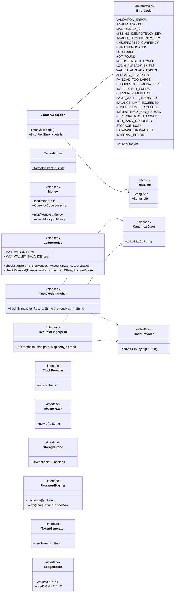
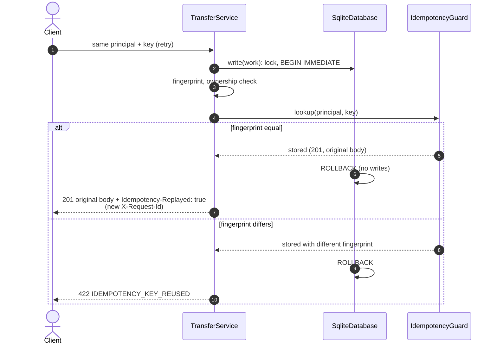
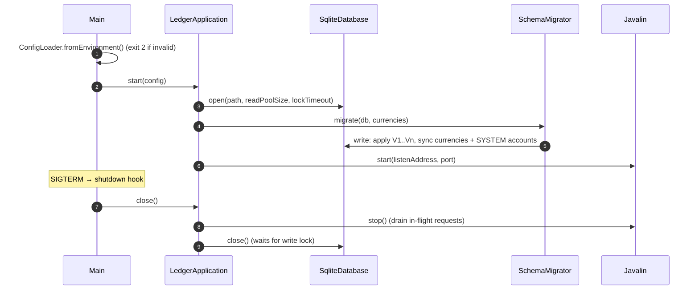

# UML Diagrams

**Stage:** 2 (Design) · **Requirement:** DC-8 · **Architecture:** [`architecture.md`](architecture.md) · **Schema:** [`data-model.md`](data-model.md)

Class names match the source tree under `src/main/java/org/ledgerapi`. Classes marked `<<planned>>` are designed here and implemented in Stage 3 ([plan](../plan.md)); every other class already exists. A material change to any class or flow shown here must update this file in the same pull request (DC-8).

---

## 1. Class Diagram

### 1.1 Domain and provider ports



### 1.2 Application, infrastructure and HTTP

```mermaid
classDiagram
    direction TB
    class LedgerApplication {
        +start(AppConfig) LedgerApplication$
        +port() int
        +close()
    }
    class Main {
        +main(String[])$
    }
    class AppConfig {
        <<record>>
        listenAddress, port, databasePath
        currencies, sessionLifetime, passwordHash
        adminKeys, trustedProxies, readPoolSize, lockTimeout
    }
    class ConfigLoader {
        +fromEnvironment() AppConfig$
        +load(Map) AppConfig$
    }
    Main ..> ConfigLoader
    Main ..> LedgerApplication
    ConfigLoader ..> AppConfig

    class HealthService {
        +check() HealthReport
    }
    class UserService {
        <<planned>>
        +register(RegisterRequest) UserView
        +get(Principal, userId) UserView
    }
    class WalletService {
        <<planned>>
        +create(Principal, userId, currency) WalletView
        +get(Principal, walletId) WalletView
        +entries(Principal, walletId, limit, before) EntryPage
    }
    class TransferService {
        <<planned>>
        +transfer(Principal, key, TransferRequest) StoredResponse
    }
    class FundingService {
        <<planned>>
        +fund(Principal, key, walletId, FundingRequest) StoredResponse
    }
    class ReversalService {
        <<planned>>
        +reverse(Principal, key, transactionId, reason) StoredResponse
    }
    class TransactionPoster {
        <<planned>>
        +post(Connection, PostingPlan) TransactionRecord
    }
    class IdempotencyGuard {
        <<planned>>
        +lookup(Connection, principal, key, fingerprint) Optional~StoredResponse~
        +record(Connection, principal, key, fingerprint, StoredResponse)
    }
    class ReconciliationService {
        <<planned>>
        +run() ReconciliationReport
    }
    class AuthService {
        <<planned>>
        +login(loginName, password, clientIp) Session
        +authenticateBearer(token) Principal
        +authenticateAdmin(apiKey) Principal
        +logout(Principal)
        +logoutAll(Principal)
    }
    TransferService --> IdempotencyGuard
    TransferService --> TransactionPoster
    FundingService --> IdempotencyGuard
    FundingService --> TransactionPoster
    ReversalService --> IdempotencyGuard
    ReversalService --> TransactionPoster

    class SqliteDatabase {
        -Connection writer
        -BlockingQueue~Connection~ readers
        -ReentrantLock writeLock
        +open(Path, int, Duration) SqliteDatabase$
        +write(Work~T~) T
        +read(Work~T~) T
        +isReachable() boolean
        +close()
    }
    class SchemaMigrator {
        +CURRENT_SCHEMA_VERSION int$
        +migrate(SqliteDatabase, List~CurrencySpec~)
    }
    class SystemClock
    class RandomUuidGenerator
    class Sha256HashProvider
    class Argon2idPasswordHasher {
        <<planned>>
    }
    SqliteDatabase ..|> StorageProbe
    SqliteDatabase ..|> LedgerStore
    SystemClock ..|> ClockProvider
    RandomUuidGenerator ..|> IdGenerator
    Sha256HashProvider ..|> HashProvider
    Argon2idPasswordHasher ..|> PasswordHasher
    SchemaMigrator --> SqliteDatabase
    HealthService --> StorageProbe

    class HttpApi {
        +REQUEST_LOGGER String$
        +create(HealthService) Javalin$
    }
    class RouteTable {
        +add(method, pathPattern)
        +allowedMethods(path) Set~String~
    }
    class RequestIds {
        +resolve(List~String~ supplied) String$
    }
    class LogSanitizer {
        +path(String) String$
    }
    class ErrorResponses {
        +envelope(ErrorCode, message, details) Map$
        +write(Context, ErrorCode, message, details)$
    }
    class HealthHandler
    class AuthFilter {
        <<planned>>
    }
    class RequestParser {
        <<planned>>
        +parseObject(body, schema) ParsedBody
        +amount(JsonToken) long
    }
    HttpApi --> RouteTable
    HttpApi --> RequestIds
    HttpApi --> LogSanitizer
    HttpApi --> ErrorResponses
    HttpApi --> HealthHandler
    HttpApi --> AuthFilter
    HealthHandler --> HealthService
    AuthFilter --> AuthService
    LedgerApplication --> SqliteDatabase
    LedgerApplication --> HttpApi
```



The two diagrams show one model; they are split only for readability. `SqliteDatabase` already provides `write`/`read`; extracting the planned `LedgerStore` port is a Stage 3 task, after which the services depend on the port rather than the class. `domain` has no outward arrows except to the JDK; `application` depends on `domain` and the provider ports; `infrastructure` implements the ports ([ADR-0002](../adr/0002-layered-hexagonal-architecture.md)).

---

## 2. Sequence Diagrams

### 2.1 New transfer (FR-2.3, FR-3.1, FR-4.5)

```mermaid
sequenceDiagram
    autonumber
    actor C as Client (USER)
    participant H as HttpApi + AuthFilter
    participant T as TransferService
    participant D as SqliteDatabase
    participant I as IdempotencyGuard
    participant P as TransactionPoster
    C->>H: POST /api/v1/transfers<br/>Bearer, Idempotency-Key, JSON
    H->>H: media type, size, X-Request-Id
    H->>H: authenticate session → principal user:<id>
    H->>H: parse + validate (ids, key, amount token)
    H->>T: transfer(principal, key, request)
    T->>D: write(work)
    D->>D: tryLock(lockTimeout); BEGIN IMMEDIATE
    T->>T: fingerprint = SHA-256(canonical F)
    T->>D: load source wallet
    alt source missing / not owned
        T-->>H: 404 NOT_FOUND / 403 FORBIDDEN (rollback)
    end
    T->>I: lookup(principal, key)
    I-->>T: none
    T->>T: destination exists, different wallets, currency, funds, limit
    T->>P: post(plan)
    P->>D: MAX(sequence)+1, MAX(entry_number)+1,+2
    P->>D: last hash (or 64 zeros)
    P->>P: hash = SHA-256(canonical H)
    P->>D: INSERT ledger_transaction, 2 × ledger_entry
    P->>D: UPDATE account balance × 2 (addExact/subtractExact)
    T->>I: record(principal, key, fingerprint, 201 body)
    D->>D: COMMIT; unlock
    T-->>H: StoredResponse(201, body)
    H-->>C: 201 Created + transaction JSON
    H->>H: log ledger.transaction {transactionId, sequence}
```

### 2.2 Replay and key reuse (FR-2.6, FR-2.7)



A replay is answered before any balance or reversal check, so it succeeds even if the balance has since changed (SRS §4.4). It writes no `ledger.transaction` log record (NFR-OBS-2).

### 2.3 Concurrent debits on one wallet (FR-3.2, FR-3.3)

```mermaid
sequenceDiagram
    autonumber
    actor A as Request A (key k1)
    actor B as Request B (key k2)
    participant L as Fair write lock
    participant DB as SQLite (writer)
    Note over A,B: source balance 100; each debits 60
    A->>L: tryLock
    B->>L: tryLock (waits, fair queue)
    L-->>A: acquired
    A->>DB: BEGIN IMMEDIATE; balance 100 ≥ 60; post; COMMIT
    A->>L: unlock
    L-->>B: acquired
    B->>DB: BEGIN IMMEDIATE; balance 40 < 60
    DB-->>B: ROLLBACK
    B-->>B: 422 INSUFFICIENT_FUNDS (no sequence consumed)
```

### 2.4 Lock timeout (FR-3.5)

```mermaid
sequenceDiagram
    autonumber
    actor C as Client
    participant T as Service
    participant L as Fair write lock
    C->>T: POST (money-moving)
    T->>L: tryLock(LEDGER_LOCK_TIMEOUT_MS)
    L-->>T: false (held by long writer)
    T-->>C: 503 STORAGE_BUSY, Retry-After: 1
    Note over C: nothing was written; retry with the same key is safe
```

### 2.5 Funding (FR-1.7)

```mermaid
sequenceDiagram
    autonumber
    actor A as Administrator
    participant H as HttpApi
    participant F as FundingService
    participant D as SqliteDatabase
    A->>H: POST /admin/wallets/{walletId}/funding<br/>X-API-Key, Idempotency-Key, {amount, currency}
    H->>H: SHA-256(key) matches LEDGER_ADMIN_KEYS → admin:<principalId>
    H->>F: fund(principal, key, walletId, request)
    F->>D: write: lock, BEGIN IMMEDIATE
    F->>F: fingerprint; idempotency lookup
    F->>F: wallet exists (404), currency supported (400), matches (422), limit (422)
    F->>D: post: DEBIT SYSTEM[currency], CREDIT wallet
    F->>D: record idempotency; COMMIT
    F-->>A: 201 FUNDING transaction
```

### 2.6 Reversal (FR-4.2–FR-4.4)

```mermaid
sequenceDiagram
    autonumber
    actor A as Administrator
    participant R as ReversalService
    participant D as SqliteDatabase
    A->>R: POST /admin/transactions/{id}/reversal {reason?}
    R->>D: write: lock, BEGIN IMMEDIATE
    R->>R: fingerprint; idempotency lookup
    R->>D: load original
    alt missing
        R-->>A: 404 NOT_FOUND
    else original is REVERSAL
        R-->>A: 422 REVERSAL_NOT_ALLOWED
    else already reversed
        R-->>A: 409 ALREADY_REVERSED
    else
        R->>R: mirror: source ↔ destination, same amount/currency
        R->>R: debited wallet funds (SYSTEM exempt), credited limit
        R->>D: post REVERSAL (reversal_of = id); record key; COMMIT
        R-->>A: 201 REVERSAL transaction
    end
```

### 2.7 Login and authenticated request (FR-7.1–FR-7.4)

```mermaid
sequenceDiagram
    autonumber
    actor U as User device
    participant H as HttpApi
    participant S as AuthService
    participant D as SqliteDatabase
    U->>H: POST /auth/login {loginName, password}
    H->>S: login(name, password, clientIp)
    S->>S: throttle check (name, IP)
    S->>D: read app_user by login_name
    S->>S: Argon2id verify (dummy hash if user missing)
    alt invalid
        S-->>U: 401 UNAUTHENTICATED (generic)
    else valid
        S->>S: token = 32 random bytes, base64url
        S->>D: write: INSERT user_session(token_hash = SHA-256(token))
        S-->>U: 200 {accessToken, tokenType: Bearer, expiresAt, userId}
    end
    U->>H: GET /wallets/{id}, Authorization: Bearer token
    H->>S: authenticateBearer(token)
    S->>D: read session by SHA-256(token); not expired, not revoked
    S-->>H: principal user:<userId>
    H->>H: ownership: wallet.user_id = userId else 403
```

### 2.8 Reconciliation (FR-5.1–FR-5.5)

```mermaid
sequenceDiagram
    autonumber
    actor A as Administrator
    participant R as ReconciliationService
    participant D as SqliteDatabase (reader)
    A->>R: GET /admin/reconciliation
    R->>D: read(work): one deferred snapshot
    D-->>R: snapshotSequence, all accounts, transactions, entries (ordered)
    R->>R: C1 structure, C2 balanced totals (BigInteger)
    R->>R: C3 stored = credits − debits, C4 bounds
    R->>R: C5 conservation + one SYSTEM per currency
    R->>R: C6 gap-free numbering + recompute hash chain
    R->>R: C7 reversal integrity
    R-->>A: 200 {status, checkedAt, snapshotSequence, counts, totals, discrepancies}
    Note over R: corrupt data ⇒ INCONSISTENT; failure to execute ⇒ 500
```

### 2.9 Startup and graceful shutdown (FR-6.2, FR-6.3)


