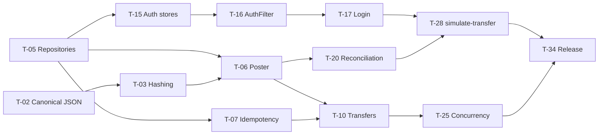

# Development Plan and Task Breakdown

**Stage:** 2 (Design) · **Specification:** [`docs/srs.pdf`](srs.pdf) · **Design:** [`docs/design/`](design/architecture.md) · **Traceability:** [`docs/traceability.md`](traceability.md)

This plan breaks the remaining work into issue-sized tasks. Each task becomes one GitHub issue and normally one pull request (PC-7). IDs (`T-xx`) are stable; put them in issue titles, e.g. `T-12: TransferService with idempotency`.

---

## 1. Milestones

| Milestone | Scope | Exit criteria |
|-----------|-------|---------------|
| **M1 Stage 2: Design** | Architecture, UML/ER, ADRs, OpenAPI, plan, traceability, brain-refine, brain-query, local-check v1 | This document set merged; validators and `local-check` pass; stage-2 review note and skill evaluations recorded |
| **M2 Core ledger** | Domain values, canonical JSON, hashing, repositories, funding, transfers, reversals | FR-1, FR-2, FR-3, FR-4 system tests pass; coverage gate ≥ 85% |
| **M3 Auth and operations** | Registration, login, sessions, admin keys, throttling, ownership, reconciliation | FR-5, FR-7, NFR-SEC tests pass |
| **M4 Stage 3: Testing and CI** | Fault injection, crash recovery, stress, precision, simulate-transfer, CI matrix, defect log | TQ-1…TQ-8 evidence; simulate-transfer PASS; traceability updated |
| **M5 Stage 4: Review** | Performance runs, user/developer docs, release tag, changelog, demo script | SRS §11.1 acceptance list satisfied |

---

## 2. Already in place (Stage 2 foundation)

These exist so that the ADRs and `local-check` act on real code. They are not feature work.

| Done | Evidence |
|------|----------|
| Maven build, wrapper, quality gates (Spotless, `-Werror`, JaCoCo 85%, Enforcer, shaded jar) | `pom.xml`, [ADR-0011](adr/0011-build-quality-gates-and-ci.md) |
| Configuration loading and validation | `ConfigLoaderTest` |
| SQLite storage: pragmas, single writer, fair lock, read snapshots, lock timeout | `SqliteDatabaseTest` |
| Schema V1 with constraints and append-only triggers, migrator, currency sync | `SchemaMigratorTest` |
| Error catalogue and envelope, request ids, log sanitising, 404/405 | `ErrorCodeTest`, `HttpSupportTest` |
| `GET /health` and structured request log | `HealthSystemTest` |

---

## 3. Task Breakdown

Size: **S** ≤ half a day, **M** ≤ 2 days, **L** ≤ 4 days. "Deps" lists tasks that must merge first.

### M2: Core ledger

| ID | Task | Requirements | Size | Deps | Tests |
|----|------|--------------|------|------|-------|
| T-01 | `Money`, `CurrencyCode`, UUID validation, checked arithmetic | BR-1, BR-7, BR-12, DC-5, NFR-API-2 | S | – | unit |
| T-02 | `CanonicalJson` with ADR-0004 test vectors | FR-2.5, FR-4.5 | S | – | unit |
| T-03 | `RequestFingerprint` and `TransactionHasher` | FR-2.5, FR-4.5 | S | T-02 | unit, known vectors |
| T-04 | `RequestParser`: media type, size, duplicate members, unknown fields, amount token rules, field order | NFR-API-1/3/7, NFR-SEC-1/2, NFR-DOC-3 | M | T-01 | unit, negative |
| T-05 | Extract `LedgerStore` port; repositories for accounts, wallets, transactions, entries, idempotency | DC-4, NFR-MNT-1, NFR-SEC-3 | M | – | integration |
| T-06 | `TransactionPoster`: sequence and entry allocation, balance updates, hash extension | BR-4, BR-5, BR-11, FR-3.1, FR-4.5 | M | T-03, T-05 | integration |
| T-07 | `IdempotencyGuard`: lookup, replay, reuse, record | FR-2.6–FR-2.10 | S | T-05 | integration |
| T-08 | User registration (temporary without auth until T-15) and wallet creation | FR-1.1–FR-1.6 | M | T-04, T-05 | system, negative |
| T-09 | Funding endpoint | FR-1.7, FR-1.8 | M | T-06, T-07 | system, negative |
| T-10 | Transfer endpoint with SRS §4.4 order | FR-2.1–FR-2.4 | M | T-06, T-07 | system, negative |
| T-11 | Transaction retrieval with derived `reversedBy` | FR-2.11 | S | T-06 | system |
| T-12 | Reversal endpoint | FR-4.2–FR-4.4, BR-9 | M | T-06, T-07 | system, negative |
| T-13 | Wallet entries with cursor pagination | FR-4.6, FR-4.7 | S | T-05 | system, negative |
| T-14 | `ledger.transaction` log after commit; no record for replays | NFR-OBS-1/2 | S | T-09 | integration |

### M3: Auth and operations

| ID | Task | Requirements | Size | Deps | Tests |
|----|------|--------------|------|------|-------|
| T-15 | `Argon2idPasswordHasher`, `TokenGenerator`, session store | FR-7.1, FR-7.2, NFR-SEC-4 | M | T-05 | unit, integration |
| T-16 | `AuthFilter`: Bearer sessions, admin keys, roles, principals | NFR-API-5, FR-7.4, SRS §4.6 | M | T-15 | system, negative |
| T-17 | Login, logout, logout-all | FR-7.1–FR-7.3 | S | T-16 | system |
| T-18 | Ownership rules on every route | NFR-SEC-7, A-1 | M | T-16 | negative |
| T-19 | Login and registration throttling, trusted proxies | NFR-SEC-9 | M | T-17 | system, negative |
| T-20 | Reconciliation C1–C7 on one snapshot | FR-5.1–FR-5.5, BR-10, BR-12 | L | T-06 | unit, integration |
| T-21 | Corruption tests for every check | FR-5.6 | M | T-20 | integration |
| T-22 | Graceful shutdown under load | FR-6.3 | S | T-10 | integration |

### M4: Stage 3, testing and CI

| ID | Task | Requirements | Size | Deps | Tests |
|----|------|--------------|------|------|-------|
| T-23 | Fault injection at each persistence boundary | FR-3.8, NFR-REL-2 | M | T-10 | integration |
| T-24 | Process-kill crash recovery with retry by original key | NFR-REL-1, FR-3.8 | M | T-10 | integration |
| T-25 | Concurrency: same key, different keys, shared source, lock timeout | FR-2.10, FR-3.2–FR-3.6 | M | T-10 | integration, stress |
| T-26 | Precision suite and float/double inspection | TQ-6, NFR-SEC-2 | S | T-04 | unit, CI grep |
| T-27 | Architecture rule test (no Javalin/JDBC in domain/application) | NFR-MNT-1 | S | – | unit |
| T-28 | `simulate-transfer` skill and script | SK-3, SK-8 | M | T-17, T-20 | skill evaluation |
| T-29 | CI: Windows leg, gitleaks, test reports | PC-8, NFR-POR-1, NFR-SEC-4 | S | – | CI run |
| T-30 | Defect log and regression-test convention | PC-10, TQ-8 | S | – | review |

### M5: Stage 4, review

| ID | Task | Requirements | Size | Deps | Tests |
|----|------|--------------|------|------|-------|
| T-31 | Performance harness and recorded runs | NFR-PERF-1–5 | L | T-20 | performance |
| T-32 | User and developer documentation | NFR-DOC-2 | M | T-19 | review |
| T-33 | OpenAPI conformance test against live server | NFR-DOC-1 | S | T-19 | system |
| T-34 | Release tag `v1.0.0`, changelog, demo script | PC-7, SRS §11.2 | S | all | review |

---

## 4. Critical Path

Transfers, reconciliation and authentication are the long poles; they unblock `simulate-transfer`, which gates Stage 3.

---

## 5. Working Agreement

* Branch per task: `feat/T-10-transfers`, `docs/T-32-user-guide`, `fix/<issue>-<slug>` ([CONTRIBUTING](../CONTRIBUTING.md)).
* A PR changes code, tests, OpenAPI, diagrams and traceability together when the contract changes (SRS §10.2, DC-8).
* `./mvnw verify` and the three validators must pass locally before review; `python3 scripts/local_check.py` before merging anything that touches startup or HTTP.
* Every PR gets at least one review from another member (PC-7).

---

## 6. Risks

| Risk | Impact | Mitigation |
|------|--------|------------|
| Single writer limits throughput below NFR-PERF-2 | Performance target missed | Measure early (T-31 smoke run after T-10); keep write transactions short; prepared statements |
| Javalin / Jetty thread behaviour under graceful shutdown | FR-6.3 flakiness | T-22 test with in-flight requests |
| Argon2 cost slows system tests | Slow CI | Tests use minimum SRS parameters; production parameters benchmarked |
| WSL / Windows filesystem slowness | Slow local builds | JaCoCo limited to project classes; CI on native runners |
| Scope pull from optional FR-8/FR-9 | Core slips | Optional extensions only after M4 |
